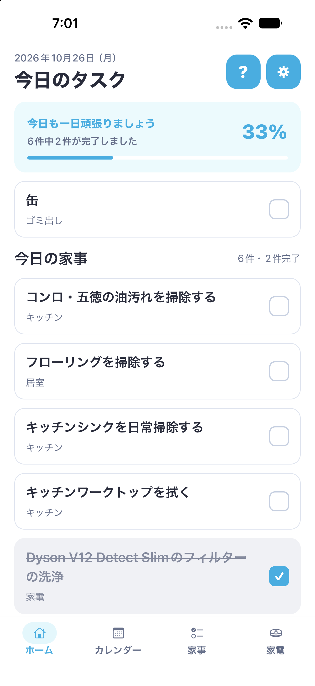
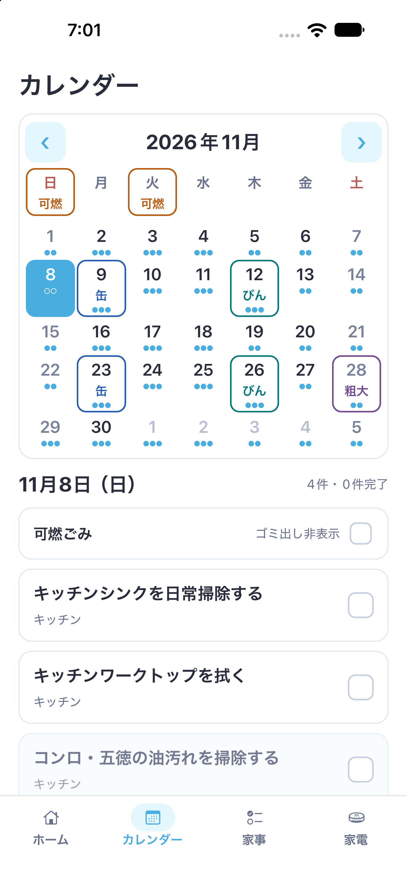
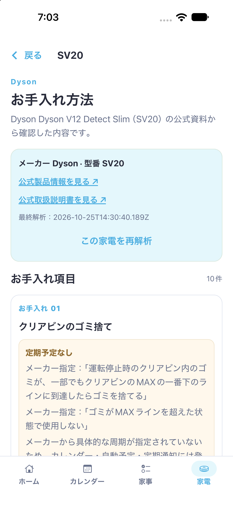
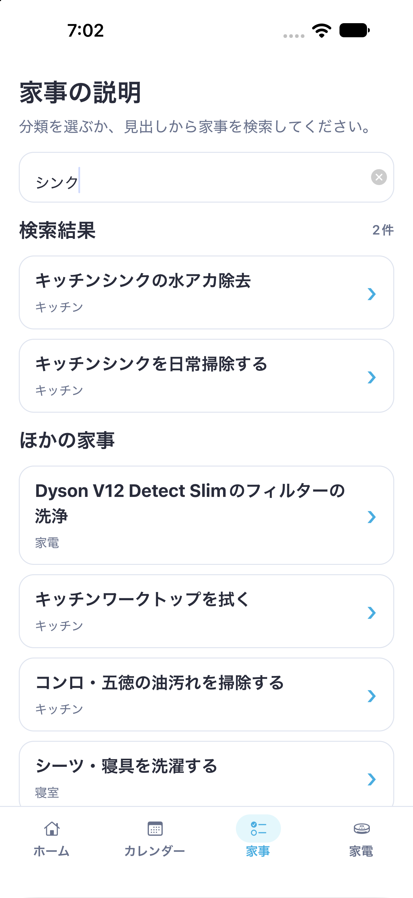
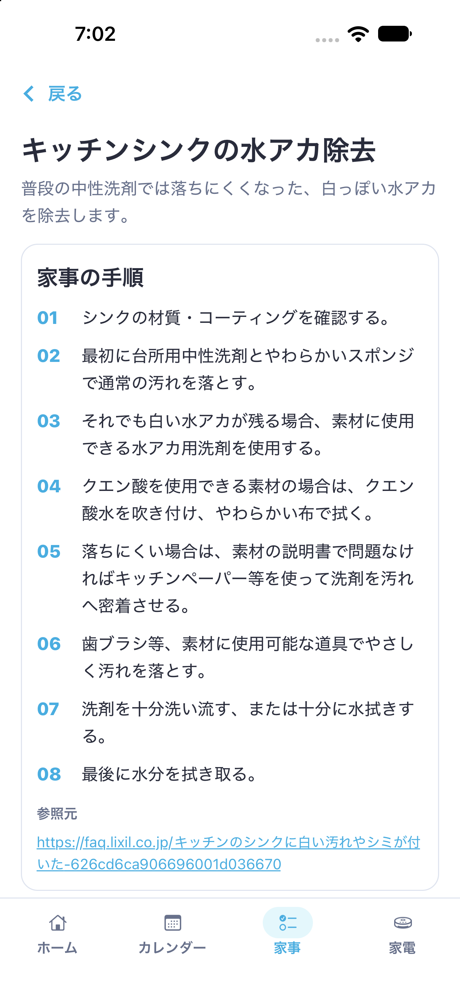
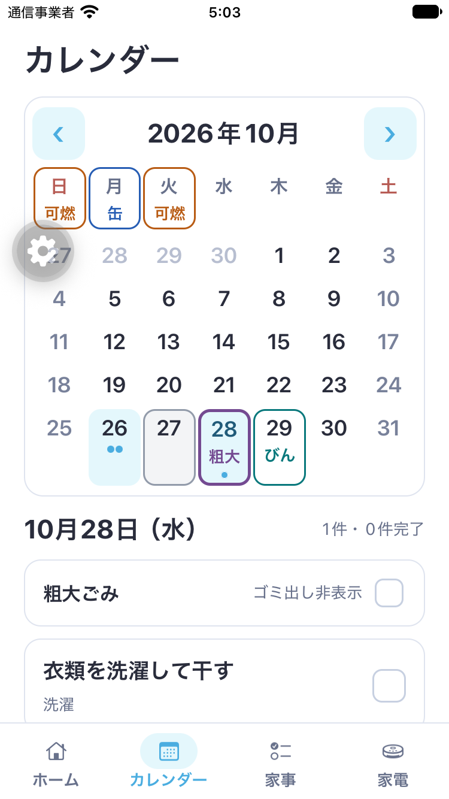
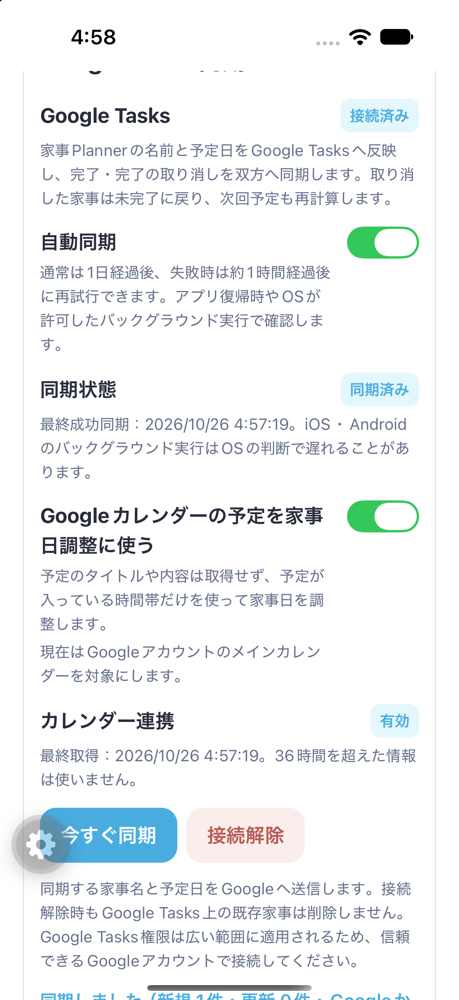
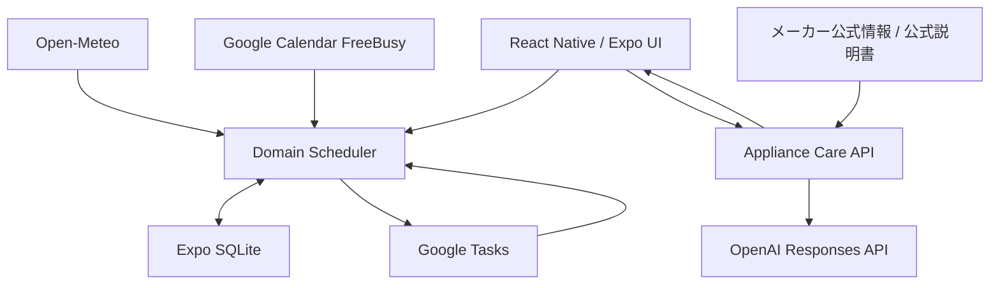

# LiFlow

> **家事を記録するだけではなく、家事を「いつ・何を・どうやるか考える負担」まで減らす。**

周期、家事の負荷、休日、天気、Google Calendarの忙しさを考慮して、家事を行うタイミングを自動で調整する家事Plannerです。

Google Tasksとも連携し、Plannerが決めた予定を普段使うGoogle側で確認・完了できます。完了結果はPlannerへ戻り、**実際に家事を行った日から次回予定を自動計算**します。

家電については、メーカー名・製品名・型番から**メーカー公式情報・公式説明書を確認し、AIでお手入れ方法を構造化**します。

通常の家事管理・Scheduler・履歴は端末内のExpo SQLiteで動作し、外部APIが利用できない場合でも基本機能を継続できます。

---

## 暗号化共有グループ（開発中）

個人データを残したまま、共有グループを別の作業領域として追加する機能を実装中です。家事・完了/取り消し・ゴミ・確認済み家電情報を端末で暗号化し、Firestoreには暗号文を保存します。招待には所有者の明示的な承認が必要です。個人利用にログインは不要です。

SQLiteと送信待ち操作の同時保存、競合の確認、鍵更新、Snapshotによる復旧、共通タイムゾーンの予定計算、共有画面と既存の単一workerへの接続を実装しました。Google Tasks/Calendar・通知・Widget・APIキーは個人用と区別します。

Android 10実機とiPhone 12で、別々の実Googleアカウント・本番Firestoreを使い、参加承認、家事の更新、完了と取り消し、オフライン保存と再送、再起動、所有者引き継ぎ、除名と再参加を確認しました。両端末の共有状態も照合しています。[実機検査の範囲と修正](docs/shared-native-interoperability-2026-10-27.md)に記録しています。

Androidでは、バックグラウンドで待機処理が止まるSDKの互換問題を修正し、強制起動したworkerによる受信と終了を実機で確認しました。iPhoneでも開発用強制起動APIからworkerの完了を確認しています。

追加の[信頼性監査](docs/workspace-reliability-audit-2026-10-27.md)では、画面離脱後の古い処理、グループ間の失敗連鎖、保存中の権限変化を修正し、変更のない共有予定の再計算を抑えました。 [依存関係対策](docs/dependency-security-2026-10-27.md)ではZod・node-forgeを公式修正版へ更新し、npm auditの既知警告を0件にしています。

[共有編集の追加監査](docs/shared-group-editing-audit-2026-10-27.md)では、古い編集画面からの上書き、収集ルールの同時変更、競合解決中の権限変化を修正しました。AndroidとiPhoneの実機でオフライン編集・再起動・再送・競合解決を行い、両端末の状態一致を確認しています。競合など確認が必要な項目は通常の画面にも案内を表示します。

[グループv2仕様](docs/sharing-v2/01-specification.md)に基づく拡張は別段階で開発しています。共通枠・担当・日時権限の基礎、schema2の保存、受信業務権限、署名付きSnapshotを自動検査しています。申請・回答の状態は専用DBへ投影しますが、v2のUI・承認結果から正式予定を更新する処理・本人専用Calendar同期はまだ有効化しておらず、実機で確認済みの既存グループはv1のままです。[進捗と未接続部分](docs/sharing-v2/05-progress.md)を参照してください。

OSによる自然なBackgroundTask実行、独立した外部セキュリティ監査は未完了です。Apple認証の実サービス設定はDeveloper Program契約待ちです。完成済み機能としての一般公開はまだ行いません。[設計・検証状況と残る作業](docs/shared-groups-design.md)を参照してください。

---

## 🎬 デモ動画

[▶ YouTubeでデモ動画を見る（約3分22秒）](https://youtu.be/RIMiwtUhU-I)

動画は限定公開です。上記リンクから視聴できます。

### デモで確認できること

```text
家事予定を自動生成
        ↓
天気とGoogle Calendarの忙しさを考慮
        ↓
Google Tasksへ同期
        ↓
アプリ / Google側で完了
        ↓
完了履歴へ反映
        ↓
次回予定を自動計算
```

---

# アプリ画面

<p align="center">
  
  
  
</p>

<p align="center">
  <b>今日のタスク</b>　／　<b>家事カレンダー</b>　／　<b>公式説明書を利用した家電お手入れ解析</b>
</p>

### 家事を検索して、具体的な手順まで確認

<p align="center">
  
  
</p>

家事名を検索し、具体的な手順・注意事項・参照元まで確認できます。

---

# 製品概要

## 背景・解決したい課題

家事には単純な「やる / やらない」以外にも、多くの判断が必要です。

- 何をやればいいのか分からない
- どのくらいの頻度で行えばいいのか分からない
- 今日やるべきか、数日ずらしてもいいのか分からない
- 休日にまとめて行いたい
- 重い家事が同じ日に集中すると負担が大きい
- 洗濯は天気によって予定を変えたい
- 忙しい日は負荷の高い家事を避けたい
- 家電のお手入れ方法を説明書から探すのが大変
- 完了した後、次にいつ行うか再び考える必要がある

一般的なToDoアプリでは、ユーザー自身が

```text
何をする？
↓
いつする？
↓
期限は？
↓
終わった？
↓
次はいつ？
```

を継続して管理する必要があります。

このアプリでは、**家事そのものだけではなく「家事を管理するための判断」も減らすこと**を目指しています。

---

## このアプリが考えること

```text
何を？
→ 家事カタログ / 家電AI

いつ？
→ Scheduler / 休日 / 負荷 / 天気 / Google Calendar

どうやって？
→ 家事ガイド / メーカー公式説明書AI

終わった？
→ App / Widget / Google Tasks

次は？
→ 実際の完了日からSchedulerが再計算
```

---

# 特長

## 1. 家事を自動で分散するScheduler

家事ごとに、

- 実施周期
- 実施可能期間
- 家事の負荷
- 休日優先
- 前回の実施日
- 家事同士の依存関係
- 最大移動日数

を持ち、共通のSchedulerが予定を生成します。

例えば、

- 重い家事が同じ日に集中しないようにする
- 休日向きの家事を休日付近へ配置する
- 前回いつ行ったか分からない家事を初回から分散する
- 期限を過ぎた家事も消さず、現在の負荷に合わせて再提案する
- 実際に完了した日を次回周期の基準にする
- 家事同士の実行順序を維持する

といった処理を自動で行います。

予定日は固定された「締切」ではなく、**一定範囲の中で移動できる実施可能期間**として扱います。

---

## 2. 天気とGoogle Calendarの両方を見て予定を調整

例えば、

> **「明日は予定が多いので、重い掃除を今日へずらす」**

といった判断をPlannerが行います。

Google Calendar連携を有効にすると、Calendarの忙しさを日ごとの時間量へ変換し、Schedulerの候補選択へ反映します。

ただし予定のある日を単純に禁止するわけではありません。

Calendarは**soft penalty**として扱い、

- 家事の実施可能期間
- 最大移動日数
- 休日
- 1日の家事負荷
- 家事同士の依存関係
- 期限超過

などの既存ルールを維持します。

重い家事ほど忙しい日を避けやすくし、軽い家事は多少予定があっても近い日を維持しやすくしています。

さらに洗濯では、

```text
天気条件を満たす日
+
Calendarの忙しさ
+
負荷上限
+
依存関係
+
同じ家事の周期順序
```

を組み合わせて候補日を決定します。

<p align="center">
  
</p>

### 古い天気結果で新しい予定を上書きしない

天気取得中に、

- 日付
- timezone
- Calendar
- 家事設定
- Plannerのsnapshot

が変更された場合、遅れて返ってきた古い結果を保存しません。

同じ予報の短時間での再評価も抑制し、不要なAPI通信・DB更新・Widget更新を増やさないようにしています。

---

## 3. Calendarの予定内容を取得しない

Google Calendar連携で必要なのは、

```text
「その日に何分予定が入っているか」
```

だけです。

そのためGoogle Calendar Events一覧ではなく、**FreeBusy APIのみ**を利用します。

取得しないもの：

- 予定タイトル
- 説明
- 場所
- 参加者
- 主催者
- Event本文

取得したraw busy intervalもそのまま永続保存しません。

保存するのは日ごとの、

```text
日付
busyMinutes
timezone
取得時刻
```

だけです。

家事の予定調整に不要なCalendar情報を取得しない設計にしています。

---

## 4. Google Tasksとの双方向連携

Plannerが生成した家事予定を専用のGoogle Tasksリストへ同期します。

新しいTaskを作る範囲は、当日から14日先までです。Planner内の長期予定は保持し、日が進むと対象範囲へ入った予定を追加します。既に紐付いたTaskは、範囲外でも予定日・名前・完了状態の更新を続けます。

作成・更新は1リクエストあたり最大100件に分割し、成功した項目から紐付けを保存します。途中で失敗した場合は、次の同期で残った差分を処理します。ローカル初期化後も、専用リストの家事名と予定日が一致するTaskを再利用して重複作成を抑えます。

```text
Planner
↓
家事予定を生成
↓
Google Tasksへ同期
↓
Google Calendar上でも確認
```

Planner側で予定日が変わっても、Google Taskを削除・再作成しません。

```text
同じGoogle Task IDを維持
+
dueだけ更新
```

します。

Google側で家事を完了した場合は、

```text
Google Taskを完了
↓
Plannerへ取り込む
↓
完了履歴へ保存
↓
家事状態を更新
↓
Scheduler再計算
↓
次回予定生成
```

までつながります。

同じ完了を何度同期しても、完了履歴を二重生成しません。

家事の完了・完了取り消し後はGoogle Tasksをすぐ同期しますが、Calendarまで毎回再取得せず、Calendarは通常の更新間隔を維持します。

設定画面の「今すぐ同期」を実行した場合だけ、TasksとCalendarの両方を明示的に更新します。

---

## 5. 天気に合わせて洗濯予定を調整

ユーザーが設定した市区町村を使ってOpen-Meteoから予報を取得し、今後7日以内の洗濯予定を調整します。

候補日の判定では、

- 降水確率
- 降水量
- 天気コード
- 元の実施可能期間
- 1日の家事負荷
- 家事の依存関係
- Google Calendarの忙しさ

を利用します。

天気APIが利用できない場合は、通常Schedulerの予定へ戻ります。

端末GPSや位置情報権限は使用せず、ユーザーが入力・選択した市区町村のみを利用します。

---

## 6. 家事を検索して「どうやるか」まで確認

予定だけ提示されても、

> 「で、どう掃除するの？」

が残ってしまいます。

そのため家事には、

- 手順
- 必要な道具
- 注意事項
- 参照元
- 過去の実施履歴

を持たせています。

例えば「シンク」で検索すると関連する家事を探すことができ、個別画面では水アカ除去などの具体的な手順を確認できます。

<p align="center">
  
  
</p>

---

## 7. 型番からメーカー公式説明書をAI解析

家電のお手入れでは、一般的なAI知識だけを使って回答させません。

```text
メーカー名・製品名・型番
        ↓
メーカー公式情報から製品を確認
        ↓
対象型番の公式説明書を特定
        ↓
公式PDF / 公式資料をAIで解析
        ↓
お手入れ項目
手順
注意事項
周期
出典
を構造化
        ↓
ユーザーが確認
        ↓
保存
        ↓
周期がある項目だけSchedulerへ登録
```

製品同定と説明書検索ではメーカー公式情報を優先します。

### AIに存在しない周期を作らせない

例えばメーカー資料に、

```text
定期的に確認する
```

とだけ書かれている場合、

```text
30日に1回
```

のような数値周期をAIに推測させません。

この場合は、

```text
定期予定なし
```

として保存します。

実際のDyson V12 Detect Slim（SV20）の解析画面でも、メーカーが具体的な周期を指定していない項目は「定期予定なし」として表示します。

<p align="center">
  
</p>

公式製品ページ・公式取扱説明書へのリンクも保持し、解析内容の根拠をユーザー自身が確認できます。

---

# メインデモの流れ

このアプリの中心は、各機能を別々に使うことではなく、**家事管理の判断を一周して自動化すること**です。

```text
① 家事を登録
   ↓
② Schedulerが周期・負荷・休日から予定を生成
   ↓
③ 洗濯なら天気を考慮
   ↓
④ Google Calendarの忙しさを考慮
   ↓
⑤ Google Tasksへ同期
   ↓
⑥ Googleまたはアプリ側で完了
   ↓
⑦ Plannerへ完了履歴を保存
   ↓
⑧ 実際の完了日から次回予定を自動計算
```

家電については、

```text
型番を入力
↓
公式製品を特定
↓
公式説明書を解析
↓
「どう手入れするか」を構造化
↓
周期があるものだけSchedulerへ追加
```

という別の入口から、同じPlannerへ統合します。

---

# 実GoogleアカウントでのE2E検証

Google連携はmockだけでなく、**iOS Simulator + 実Googleアカウント**でも一連の動作を確認しています。

検証例：

```text
11月24日
Calendar busy = 270分

11月23日
Calendar busy = 90分

↓
heavy家事を比較

11月24日
↓
11月23日へ移動

↓
同じGoogle Task IDを維持
dueだけ更新

↓
Google側でTaskを完了

↓
Plannerへ完了を1件だけ取り込み

↓
次回予定を再計算

↓
アプリを完全終了・再起動

↓
完了履歴・次回予定・Calendar状態を保持
```

つまり、

```text
Calendar
↓
Scheduler
↓
Google Tasks
↓
Google側で完了
↓
Planner
↓
次回Scheduler
```

まで一周させています。

<p align="center">
  
</p>

詳細：

- [`docs/google-sync-phase1-report.md`](./docs/google-sync-phase1-report.md)
- [`docs/google-sync-phase2-report.md`](./docs/google-sync-phase2-report.md)
- [`docs/google-sync-phase3-report.md`](./docs/google-sync-phase3-report.md)
- [`docs/google-undo-and-audit-2026-10-25.md`](./docs/google-undo-and-audit-2026-10-25.md)

---

# 家電AIの実API検証

家電AIについても、

> 「AIがそれっぽい回答をした」

だけでは評価していません。

メーカー公式説明書から人力で正解データを作成し、実際のアプリと同じAPI経路で比較しました。

対象：

```text
Dyson V12 Detect Slim
型番: SV20
公式日本語取扱説明書
```

GPT-5.5を利用した3回のE2E検証：

| 指標 | 結果 |
|---|---:|
| E2E成功 | 3 / 3 |
| 製品同定 | 3 / 3 |
| 正しい公式説明書 | 3 / 3 |
| Task Recall | 10 / 10 × 3 |
| Task Precision | 10 / 10 × 3 |
| 周期判定 | 10 / 10 × 3 |
| 主要手順 | 38 / 38 × 3 |
| 安全情報 | 33 / 33 × 3 |
| 出典 | 10 / 10 × 3 |
| 根拠のない生成 | **0** |

数値周期がメーカー資料に存在した項目以外には、根拠のない周期を生成しませんでした。

---

# 品質保証

予定・天気・Calendar・完了・Google同期は、少しの不整合でも

- 同じ家事が二重に表示される
- 完了履歴が重複する
- 次回予定がずれる
- 天気取得中に古い結果で予定が巻き戻る
- GoogleとPlannerが互いに古い状態を上書きする

といった問題が起きやすい部分です。

そのため状態遷移・UI契約・保存・同期を自動テストしています。

## 現在の検証結果

| 検証 | 結果 |
|---|---:|
| 自動テスト | **1043 tests PASS（iOS・Androidの両条件、未有効化のv2基盤を含む）** |
| lint | PASS |
| TypeScript typecheck | PASS |
| `npm run check` | PASS |
| Expo Doctor | PASS |
| GitHub Actions CI | PASS |
| 保護対象feature contract | **119機能（従来84を保持、元の44を含む）** |
| iOS Simulator + 実Google E2E | PASS |
| Android Emulator + 実Google Tasks / Calendar Phase 3 E2E | **PASS（2026-10-26）** |
| iPhone 12 + Release版（初期設定・自動保存・完了/取消・アイコン） | **PASS（2026-10-26）** |
| Sony I4293 / Android 10 + Release版（初期設定・保存・完了/取消・ゴミ・Calendar取得） | **PASS（2026-10-26）** |

さらに天気・Calendarについては、**128種類の予報・busyパターン**を使い、

- 実施可能期間
- 負荷上限
- 依存順
- 周期順序
- 完了済み予定の固定
- 元データの不変性

を確認しています。

詳細：

- [`docs/input-weather-calendar-audit-2026-10-26.md`](./docs/input-weather-calendar-audit-2026-10-26.md)
- [`docs/autosave-typography-audit-2026-10-26.md`](./docs/autosave-typography-audit-2026-10-26.md)
- [`docs/reliability-audit-2026-10-26.md`](./docs/reliability-audit-2026-10-26.md)
- [`docs/mobile-readable-layout-2026-10-26.md`](./docs/mobile-readable-layout-2026-10-26.md)
- [`docs/android-google-e2e-2026-10-26.md`](./docs/android-google-e2e-2026-10-26.md)

---

# Android native構成の検証

iOSとAndroidでnative部分の実装は完全には同一ではありません。

そのためGitHub Actionsにnative設定専用のworkflowを用意し、

```text
npm ci
↓
Expo Doctor
↓
expo prebuild --platform android
```

を実行してAndroid native projectを生成できることも確認しています。

必要に応じてworkflow_dispatchからAndroid debug appのGradle compileも実行できる構成です。

- [`.github/workflows/native-check.yml`](./.github/workflows/native-check.yml)

2026年10月26日にはローカルでもAndroid nativeをクリーン再生成・再ビルドし、**Android Emulator + 実GoogleアカウントでGoogle Tasks / Calendar Phase 3 E2E PASS**を確認しました。FreeBusyによるheavy家事の移動、同じTask IDでのdue更新、Google側の完了取込、終了・再起動後の保持を[検証記録](docs/android-google-e2e-2026-10-26.md)にまとめています。

追加の[Android機能検査と修正](docs/android-platform-audit-2026-10-26.md)では、依存家事の周期の違い、同期中断後の完了操作、アプリ終了中のウィジェット完了、地域検索を確認しました。CIの画面テストはiOS・Androidの両条件で実行します。

[Google Calendarの大量・障害・OS差分検査](docs/google-calendar-stress-audit-2026-10-26.md)では、5,120ケースの集計照合、21家事・181日分の384配置パターン、15万区間の応答、SQLiteの部分失敗、両OSの認証経路を検査しました。両OSの実アカウントでもセッション復元、Calendar連携OFF／ON、181日分の再取得と同じTask IDの維持を確認しました。

[保存・通知・家電APIなどの追加調査](docs/reliability-audit-2026-10-26.md)では、保存の終了経路、再入による同時書き込み、通知の部分失敗、iOSウィジェットの操作確認、古い履歴、APIの入力・受信上限、天気キャッシュを検査しました。100テストを追加し、既存の36保護項目を保持した上で43項目へ増やしています。Androidの初期設定・ゴミ・通知配信・家電AI登録と、iOSのXCTestによる8シナリオも確認しています。

iPhone 12の署名付きRelease版で、開発サーバー停止中の起動、初期設定、無効家事の有効化、周期の自動保存、完了・取り消しを確認しました。[LiFlowの名前・アイコンと実機検査](docs/liflow-branding-2026-10-26.md)に記録しています。Sony I4293（Android 10）でもRelease版の初期設定・保存・完了/取消・ゴミと、実Googleへの接続・Calendar取得を確認しました。[Android実機の検証範囲と修正](docs/android-physical-10-audit-2026-10-26.md)に記録しています。物理端末上でOSに長時間任せるBackgroundTaskは未検証です。

---

# Hack Dayで開発した部分

このRepositoryはJPHACKS公式テンプレートから開始しました。

Hack Day開始前の基準commit：

```text
ecf5ec752e9dfd0b938c219662d7dbf3d6d1b603
```

Hack Dayでは主に以下を開発しました。

- 家事Planner UI
- SQLiteデータモデル
- 家事Scheduler
- 実施可能期間
- 家事負荷分散
- 休日優先
- 家事依存関係
- 期限超過家事の再提案
- 完了・完了取り消し
- 月間カレンダー
- 家事検索
- 家事ガイド
- ゴミ収集日
- 通知
- iOS / Android Widget
- Open-Meteo天気連動
- 家電公式説明書AI
- Google Tasks同期
- Google側完了のPlanner取込
- Google Calendar FreeBusy連携
- Calendar busyを使ったScheduler調整
- 天気とCalendarの統合調整
- mobile UI / typography改善
- 設定の自動保存
- 自動テスト / CI
- Android native configuration CI

現在との差分：

https://github.com/jphacks/tkb_2633/compare/ecf5ec752e9dfd0b938c219662d7dbf3d6d1b603...main

---

# 注力したこと・独自技術

## 1. Schedulerを中心に機能を統合

各外部サービスがそれぞれ別々に予定を作るのではなく、

```text
周期
+
実施可能期間
+
負荷
+
休日
+
依存関係
+
天気
+
Calendar busy
```

を最終的に一つのSchedulerへ統合しています。

主要コード：

- [`src/domain/scheduling/engine.ts`](./src/domain/scheduling/engine.ts)
- [`src/domain/scheduling/calendar-penalty.ts`](./src/domain/scheduling/calendar-penalty.ts)
- [`src/domain/scheduling/completion-matching.ts`](./src/domain/scheduling/completion-matching.ts)

---

## 2. 天気とCalendarを競合させない

例えば、

> 晴れているので洗濯したい

という条件だけで日付を変更すると、

> その日はCalendar上では非常に忙しい

という問題が起こります。

逆にCalendarだけを見ると雨の日へ洗濯を移動してしまう可能性があります。

そのため、

```text
天気条件を満たす
↓
実施期間・負荷・依存関係を満たす
↓
Calendar busyも比較する
↓
候補日を決定
```

という順序で統合しています。

主要コード：

- [`src/features/weather/laundry-policy.ts`](./src/features/weather/laundry-policy.ts)
- [`src/features/weather/optimize-laundry-schedule.ts`](./src/features/weather/optimize-laundry-schedule.ts)
- [`src/features/google-sync/calendar-availability.ts`](./src/features/google-sync/calendar-availability.ts)

---

## 3. Google Calendarは必要最小限だけ取得

Calendarの内容を家事Plannerが読む必要はありません。

そのためFreeBusyだけを使い、

```text
予定の中身
```

ではなく、

```text
予定が入っている時間量
```

だけをSchedulerへ渡します。

主要コード：

- [`src/platform/google-tasks/google-calendar-freebusy-client.ts`](./src/platform/google-tasks/google-calendar-freebusy-client.ts)
- [`src/features/google-sync/calendar-coordinator.ts`](./src/features/google-sync/calendar-coordinator.ts)

---

## 4. Google Tasksを作り直さず安定IDで同期

予定日が変わるたびにGoogle Taskを削除・再作成すると、

- 重複
- ID変更
- 完了履歴の対応崩れ

が発生しやすくなります。

そのため同一予定では同じGoogle Taskを維持し、必要な値だけ更新します。

主要コード：

- [`src/features/google-sync/coordinator.ts`](./src/features/google-sync/coordinator.ts)
- [`src/features/google-sync/reconcile-google-tasks.ts`](./src/features/google-sync/reconcile-google-tasks.ts)
- [`src/platform/google-tasks/google-tasks-api.ts`](./src/platform/google-tasks/google-tasks-api.ts)

---

## 5. メーカー公式資料を基準にした家電AI

家電AIは、

```text
Product Resolver
↓
Manual Resolver
↓
Manual Analyzer
```

へ処理を分離しています。

主要コード：

- [`server/appliance-care-api/src/product-resolver.mjs`](./server/appliance-care-api/src/product-resolver.mjs)
- [`server/appliance-care-api/src/manual-resolver.mjs`](./server/appliance-care-api/src/manual-resolver.mjs)
- [`server/appliance-care-api/src/manual-analyzer.mjs`](./server/appliance-care-api/src/manual-analyzer.mjs)
- [`server/appliance-care-api/src/official-domains.mjs`](./server/appliance-care-api/src/official-domains.mjs)

---

# アーキテクチャ

通常の家事管理は端末内で完結します。

外部サービスは補助機能として接続し、外部API障害によって基本Schedulerまで停止しない構成です。



詳細：

- [`docs/architecture.md`](./docs/architecture.md)

---

# Google連携とデータの正本

Planner本体の家事DBは**端末内SQLiteが正本**です。

Google Tasksをクラウド上のPlanner DBとして利用しているわけではありません。

Google Tasksは、

- Plannerが決めた予定をGoogle環境で確認する
- Google側から家事完了を入力する

ための外部インターフェースとして扱います。

そのため、

- Plannerアカウント
- 家族間データ共有
- 複数端末間Planner DB同期

とは別機能です。

---

# プライバシー設計

## 天気

端末GPSは利用しません。

ユーザーが入力・選択した市区町村を利用します。

## Google Calendar

FreeBusyのみを利用し、Event内容を取得しません。

## 家電AI

メーカー公式情報・公式説明書を基準にし、出典を保持します。

## Planner

通常の家事データは端末内SQLiteへ保存します。

---

# 実装済み機能

## Planner

- 初回セットアップ
- 家事頻度モード
- 家事ごとの周期設定
- 休日設定
- 家事ON / OFF
- 前回実施時期
- 家事負荷
- 実施可能期間
- 最大移動日数
- 家事依存関係
- 期限超過再提案
- 完了 / 未完了履歴
- 完了取り消し
- 月間カレンダー
- 家事検索
- 家事説明
- 家事設定の自動保存

## 外部条件

- Open-Meteo天気連動
- Google Calendar FreeBusy連動
- Google Tasks連携
- Google Tasks完了取込
- 天気 + Calendar統合予定調整

## 補助機能

- 毎朝の家事通知
- iOS Widget
- Android Widget
- Widgetからの完了
- ゴミ収集曜日
- カレンダー上のゴミ種別表示

## 家電

- 家電登録
- メーカー / 製品 / 型番確認
- 公式製品情報確認
- 公式説明書検索
- OpenAI Responses API解析
- お手入れ項目
- 手順
- 注意事項
- 周期
- 公式出典
- AI結果のユーザー確認
- 再解析
- 周期あり項目のScheduler登録

---

# 現在の制限・未検証

実装済みと実機検証済みを混同しないため、未確認部分も明記します。

### Android Google連携

Android native projectの生成はCIで確認しています。

Android Emulator + 実GoogleアカウントのGoogle Tasks / Calendar Phase 3 E2Eは2026年10月26日にPASSしました。Sony I4293（Android 10）のRelease版でもGoogle接続、対象0件でのTasks同期、Calendar権限と予定時間帯の取得を確認しました。Tasksの双方向変更とheavy家事の移動を通す全シナリオは、今回の物理端末では未検証です。

### iPhone実機

iPhone 12のRelease版で基本操作を確認済みです。Google Tasks / Calendarの実アカウントE2Eと家電APIは今回の実機では未検証です。開発用プロビジョニングは2026年11月2日20:50頃（日本時間）まで有効で、その後は再ビルド・再インストールが必要です。

### 家電AIのRelease接続

Android実機の家電AIは、開発ビルドからUSB経由の実APIで解析・保存を確認しました。端末単体のRelease版で新規解析・再解析を使うには、到達可能なHTTPS APIを`EXPO_PUBLIC_APPLIANCE_CARE_API_URL`へ設定する必要があります。保存済みのお手入れ内容はRelease版でも読めます。

### BackgroundTask

物理端末上でOSに長時間任せたBackgroundTask実行は未検証です。

アプリ起動・foreground復帰・手動同期でも状態を再確認します。

### ゴミ収集日の例外

通常の曜日・月次ルールには対応しています。

自治体による祝日・臨時変更などの自動取得は未実装です。

### Plannerクラウド同期

MVPでは、

- Plannerアカウント
- 家族間同期
- 複数端末同期
- Planner DBのクラウド保存

は対象外です。

---

# 開発技術

## Mobile

- TypeScript
- React 19
- React Native 0.88
- Expo SDK 58
- Expo Router
- Expo SQLite
- Expo Notifications
- Expo Background Task
- Expo Widgets

## Google

- Google Sign-In native SDK
- Google Tasks API
- Google Calendar FreeBusy API
- react-native-nitro-google-signin

## Weather

- Open-Meteo Forecast API
- Open-Meteo Geocoding API

## AI

- OpenAI Responses API
- Structured Outputs
- PDF input
- メーカー公式Web / 公式説明書解析

## Quality

- Node Test Runner
- ESLint
- TypeScript
- Expo Doctor
- GitHub Actions
- Feature contract tests
- Android native configuration check

---

# 起動方法

このアプリはnative機能を利用するため、完全な動作確認にはExpo development buildを使用します。

## 依存関係

```bash
npm ci
```

## iOS

```bash
npm run ios
```

## Android

```bash
npm run android
```

## development server

development buildを作成済みの場合：

```bash
npm start
```

---

## 家電AI API

環境変数の例：

- [`.env.example`](./.env.example)
- [`.env.server.example`](./.env.server.example)

APIサーバー：

```bash
npm run api:dev
```

OpenAI API keyをクライアントアプリへ直接埋め込まない構成です。

---

## Google Tasks / Calendar

Google Cloud側のOAuth設定とdevelopment buildが必要です。

詳細：

- [`docs/google-sync-setup.md`](./docs/google-sync-setup.md)

Calendar連携ではGoogle Tasksとは別に、ユーザーがCalendar連携を有効にした場合だけFreeBusy用の追加権限を要求します。

---

# テスト

全テスト：

```bash
npm test
```

Android条件で画面の処理も含めて実行：

```bash
HOUSEWORK_TEST_PLATFORM=android npm test
```

lint：

```bash
npm run lint
```

typecheck：

```bash
npm run typecheck
```

まとめて確認：

```bash
npm run check
```

Expo Doctor：

```bash
npm run doctor
```

---

# Repository構成

```text
src/
├── app/                 # Expo Router / 各画面
├── components/          # UI部品
├── domain/
│   ├── chores/          # 家事定義
│   └── scheduling/      # Scheduler
├── features/
│   ├── appliance-care/  # 家電AI
│   ├── google-sync/     # Google Tasks / Calendar
│   ├── notifications/   # 通知
│   ├── planner/         # Planner更新制御
│   ├── settings/        # 設定・自動保存
│   ├── weather/         # 天気
│   ├── waste/           # ゴミ収集日
│   └── widgets/         # Widget
└── platform/
    ├── google-tasks/     # Google API adapter
    ├── notifications/
    ├── storage/          # SQLite
    └── widgets/

server/
└── appliance-care-api/
    └── src/
        ├── product-resolver.mjs
        ├── manual-resolver.mjs
        ├── manual-analyzer.mjs
        └── analysis-runner.mjs

tests/
└── *.test.mjs

docs/
├── architecture.md
├── google-sync-phase1-report.md
├── google-sync-phase2-report.md
├── google-sync-phase3-report.md
├── google-sync-setup.md
└── input-weather-calendar-audit-2026-10-26.md
```

---

# 今後の展望

- 実利用者による継続利用テスト
- Schedulerの長期利用データによる調整
- 家事・家電データの拡充
- Android物理端末でのTasks双方向変更・Calendarによる家事移動E2E
- Android / iOS物理端末でのBackgroundTask検証
- 暗号化共有グループの実機E2E・復旧フロー・セキュリティ監査の完了
- ゴミ収集日の自治体別例外対応
- 家電AI解析結果の再利用・共有cache

家電AIについては、同じ製品・同じ公式説明書を毎回AI解析するのではなく、

```text
製品型番
↓
公式説明書
↓
検証済み解析結果
```

を再利用することで、解析コストを抑えながら対応製品を増やす構成へ拡張できます。

---

# このアプリが目指すもの

家事を実行すること自体は自動化できなくても、

```text
何をやる？
いつやる？
どうやる？
前回いつやった？
今日やるべき？
忙しいからずらす？
天気は大丈夫？
次はいつ？
```

を毎回人間が考える必要はありません。

> **家事をする人ではなく、「家事を管理する人」の負担を減らす。**

それがこのアプリの目標です。
