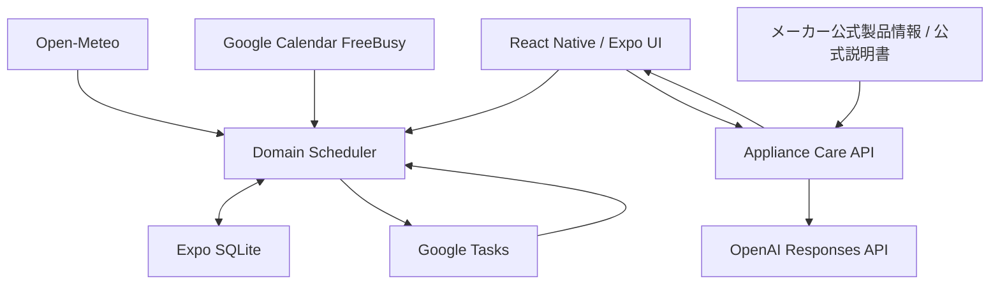

# 家事お知らせアプリ

> **家事を記録するだけではなく、家事を「いつ・何を・どうやるか考える負担」まで減らす。**

周期・家事の負荷・休日・天気・Google Calendarの忙しさをもとに、家事を行う日を自動で調整する家事Plannerです。

Google Tasksとも連携し、Plannerが決めた予定を普段使うGoogle側で確認・完了できます。Google側で完了した結果はPlannerへ戻り、実際の完了日を基準に次回予定を再計算します。

掃除機などの家電については、メーカー名・製品名・型番から**メーカー公式情報と公式説明書だけを確認し、AIでお手入れ方法を構造化**します。

通常の家事管理・Scheduler・履歴はExpo SQLite上で動作し、外部APIが利用できない場合でも基本的な家事管理を継続できます。

---

<!--
============================================================
画像置き場 0: デモ動画
============================================================

ファイル:
docs/readme/00-demo-thumbnail.png

内容:
・ホーム画面を中心にした見栄えのいい画像
・可能ならGoogle Calendar / Tasks連携が分かる要素も入れる
・YouTube等へ動画をアップロードした後、下のURLを書き換える

推奨動画:
30〜90秒

動画内容:
1. Calendar上の忙しい日を用意
2. Plannerが重い家事を別日へ移動
3. 同じGoogle Taskのdueが更新
4. Google側で完了
5. Plannerへ完了反映
6. 次回予定が再計算

撮影後、このコメント内の次の2行をコメント外へ移動:

## 🎬 デモ動画

[](ここを動画URLへ変更)

============================================================
-->

<!--
============================================================
画像置き場 1: アプリ全体
============================================================

ファイル:
docs/readme/01-home.png

撮影する画面:
ホーム画面

入っていてほしい要素:
・今日または近日中の家事
・実施期間
・完了操作
・家事が複数日に分散していることが分かる状態

注意:
・テスト用の自然な家事データにする
・デバッグ表示は入れない
・個人情報は映さない

撮影後、下の行をコメント外へ移動:


============================================================
-->

<!--
============================================================
画像置き場 2: Calendar
============================================================

ファイル:
docs/readme/02-calendar.png

撮影する画面:
Plannerの月間カレンダー

入っていてほしい要素:
・複数日に家事が配置されている
・実施可能期間が視覚的に分かる
・可能ならCalendar連携で移動した家事が確認できる

撮影後、下の行をコメント外へ移動:


============================================================
-->

<!--
============================================================
画像置き場 3: Google連携
============================================================

ファイル:
docs/readme/03-google-sync.png

最もおすすめ:
1枚の画像内で左右または上下に並べる

左:
・Planner側のGoogle連携設定
または
・Planner上の家事予定

右:
・Google Calendar / Google Tasks上の同じ家事

見せたいこと:
・Plannerの予定がGoogleへ出ている
・同じTaskを使い続けている
・Calendarを利用して日付を調整できる

重要:
実際の個人予定名は映さず、
デモ用予定だけで撮影すること。

撮影後、下の行をコメント外へ移動:


============================================================
-->

<!--
============================================================
画像置き場 4: 家電AI
============================================================

ファイル:
docs/readme/04-appliance-ai.png

撮影する画面:
家電の解析結果画面

入っていてほしい要素:
・製品名 / 型番
・お手入れ項目
・手順
・注意事項
・メーカー公式出典
・可能なら「定期予定なし」の項目

AIチャット画面ではなく、
「公式情報を構造化した製品機能」であることが分かる画面が最適。

撮影後、下の行をコメント外へ移動:


============================================================
-->

## 製品概要

### 解決したい課題

家事には、単に「やる / やらない」だけではなく、

- 何をやればいいのか分からない
- どのくらいの頻度で行えばいいのか分からない
- 今日やるべきか、数日ずらしていいのか判断が必要
- 休日にまとめたい
- 重い家事が同じ日に集中すると負担が大きい
- 洗濯は天気によって予定を変えたい
- 忙しい日は重い家事を避けたい
- 家電のお手入れ方法を説明書から探すのが面倒
- 家事を完了した後、次にいつやるか再び考える必要がある

といった問題があります。

一般的なToDoアプリでは、ユーザー自身が

```text
何をする？
↓
いつする？
↓
期限は？
↓
終わった？
↓
次はいつ？
```

を継続して管理する必要があります。

このアプリでは、**家事そのものではなく「家事を管理するための判断」まで減らすこと**を目指しています。

---

## このアプリが考えること

```text
何を？
→ 家事カタログ / 家電AI

いつ？
→ Scheduler / 休日 / 負荷 / 天気 / Google Calendar

どうやって？
→ 家事ガイド / メーカー公式説明書AI

終わった？
→ App / Widget / Google Tasks

次は？
→ 実際の完了日からSchedulerが再計算
```

---

# 主な特徴

## 1. 家事を自動で分散するScheduler

家事ごとに、

- 実施周期
- 実施できる期間
- 家事の負荷
- 休日優先
- 前回の実施日
- 家事同士の依存関係
- 日付をどこまで移動してよいか

を持ち、共通のSchedulerが予定を生成します。

例えば、

- 重い家事が1日に集中しない
- 休日向きの家事を休日付近へ配置する
- 前回いつ行ったか分からない家事を初回から分散する
- 期限を過ぎた家事も消さず、現在の負荷に合わせて再提案する
- 実際に完了した日を次回周期の基準にする
- 家事同士の順序関係を守る

といった処理を自動で行います。

予定日は単純な「締切」ではなく、**ある程度動かせる実施可能期間**として扱います。

---

## 2. Google Calendarの忙しさを見て家事日を調整

例えば、

> **「明日は予定が多いから、重い掃除を今日へずらす」**

という判断をPlannerが行います。

Google Calendar連携を有効にすると、Calendarの忙しさを日ごとの時間量へ変換し、Schedulerの候補選択へ反映します。

ただし、予定がある日を禁止するわけではありません。

Calendarはあくまで**soft penalty**として扱い、

- 家事の実施期間
- 最大移動日数
- 休日設定
- 1日の家事負荷
- 家事同士の依存関係
- 期限超過

などの既存ルールを維持します。

また、重い家事ほど忙しい日を避けやすく、軽い家事は多少予定があっても近い日を維持しやすくしています。

### Calendarの予定内容は読みません

Calendar連携で取得するのは、

```text
「何時から何時まで予定が入っているか」
```

だけです。

取得しないもの：

- 予定タイトル
- 説明
- 場所
- 参加者
- 主催者
- Event本文

Google Calendar Events一覧ではなく、**FreeBusy APIだけを使用**しています。

取得したbusy intervalもそのまま保存せず、

```text
日付
busyMinutes
timezone
取得時刻
```

だけを日単位で保存します。

---

## 3. Google Tasksとの双方向連携

Plannerが生成した家事予定を、専用のGoogle Tasksリストへ同期します。

```text
Planner
↓
家事予定を生成
↓
Google Tasksへ反映
↓
Google Calendar上でも確認可能
```

Planner側で予定日が変わった場合も、Google Taskを削除・再作成せず、

```text
同じGoogle Task ID
+
dueだけ更新
```

します。

Google側で家事を完了した場合は、

```text
Google Taskを完了
↓
Plannerへ完了を取り込む
↓
完了履歴へ保存
↓
ChoreState更新
↓
Scheduler再計算
↓
次回予定生成
```

までつながります。

同じ完了を何度同期しても、完了履歴を重複生成しません。

---

## 4. 天気に合わせて洗濯予定を調整

ユーザーが設定した市区町村を使ってOpen-Meteoから天気予報を取得し、今後7日以内の洗濯予定を調整します。

候補日は、

- 降水確率
- 降水量
- 天気コード
- 元の家事実施期間
- 1日の家事負荷
- 家事の依存関係

を確認して決定します。

天気APIが利用できない場合でも、通常のSchedulerによる予定はそのまま利用できます。

端末のGPSや位置情報権限は使用せず、ユーザーが入力・選択した市区町村だけを利用します。

---

## 5. 型番からメーカー公式説明書をAI解析

家電のお手入れでは、一般的なAI知識だけを使って回答させません。

```text
メーカー名・製品名・型番
        ↓
メーカー公式情報から製品を確認
        ↓
対象型番の公式説明書を特定
        ↓
公式PDF / 公式資料をAIで解析
        ↓
お手入れ項目
手順
注意事項
周期
出典
を構造化
        ↓
ユーザーが内容を確認
        ↓
保存
        ↓
周期がある項目だけSchedulerへ登録
```

製品同定と説明書検索では、メーカー公式情報を優先します。

### AIに存在しない周期を作らせない

メーカー資料に、

```text
定期的に確認する
```

とだけ書かれている場合、

```text
30日に1回
```

のような数値周期をAIに推測させません。

この場合は、

```text
定期予定なし
```

として保存します。

公式資料のURLやページ情報も保持し、ユーザーが元資料を確認できる設計です。

---

# メインデモ

このアプリの中心は、各機能を別々に使うことではなく、**家事管理の判断を一周して自動化すること**です。

```text
① 家事を登録
   ↓
② Schedulerが周期・負荷・休日から予定を生成
   ↓
③ 洗濯なら天気を考慮
   ↓
④ Google Calendarの忙しさを考慮
   ↓
⑤ Google Tasksへ同期
   ↓
⑥ Google側またはアプリ側で完了
   ↓
⑦ Plannerへ完了履歴を保存
   ↓
⑧ 実際の完了日を基準に次回予定を自動計算
```

家電については別の導線で、

```text
型番を入力
↓
公式製品を特定
↓
公式説明書を解析
↓
「どう手入れするか」を構造化
↓
周期があるものだけSchedulerへ追加
```

します。

---

# 実GoogleアカウントでのE2E検証

Google連携はmockだけでなく、**実Googleアカウントを利用したE2E検証**も行いました。

Phase 3検証では、例えば次のケースを確認しています。

```text
2026-11-24
busyMinutes = 270分

2026-11-23
busyMinutes = 90分

↓
heavy家事の候補日を比較

2026-11-24
↓
2026-11-23へ移動

↓
同じGoogle Task IDを維持
dueだけ更新

↓
Google側でTaskを完了

↓
Plannerへ完了を1件だけ取り込み

↓
次回予定を再計算

↓
アプリ再起動

↓
完了履歴・次回予定を保持
```

Google Calendarで予定変更を検知するだけではなく、

**Calendar → Scheduler → Tasks → Completion → Scheduler**

まで一連の流れを確認しています。

詳細：

- [`docs/google-sync-phase1-report.md`](./docs/google-sync-phase1-report.md)
- [`docs/google-sync-phase2-report.md`](./docs/google-sync-phase2-report.md)
- [`docs/google-sync-phase3-report.md`](./docs/google-sync-phase3-report.md)

---

# 品質保証

予定・完了・同期は、少しの不整合でも

- 同じ家事が二重に出る
- 完了が消える
- 次回予定がずれる
- GoogleとPlannerが無限に上書きし合う

といった問題が起きやすい部分です。

そのため、自動テストで状態遷移を固定しています。

Phase 3完成時点：

| 検証 | 結果 |
|---|---:|
| 全自動テスト | **202 / 202 PASS** |
| Google関連テスト | **105 / 105 PASS** |
| Phase 3関連テスト | **56 / 56 PASS** |
| lint | PASS |
| TypeScript typecheck | PASS |
| `npm run check` | PASS |
| Expo Doctor | PASS |
| `git diff --check` | PASS |
| 実Google E2E | PASS |

GitHub ActionsでもCIを実行しています。

---

# 家電AIの実API検証

家電AIについても、

> 「AIがそれっぽい回答をした」

だけでは評価していません。

メーカー公式説明書から人力で正解データを作成し、実際のアプリと同じAPI経路で比較しました。

検証対象：

```text
Dyson V12 Detect Slim
型番: SV20
公式日本語取扱説明書
```

GPT-5.5を使った3回のE2E検証：

| 指標 | 結果 |
|---|---:|
| E2E成功 | 3 / 3 |
| 製品同定 | 3 / 3 |
| 正しい公式説明書 | 3 / 3 |
| Task Recall | 10 / 10 × 3 |
| Task Precision | 10 / 10 × 3 |
| 周期判定 | 10 / 10 × 3 |
| 主要手順 | 38 / 38 × 3 |
| 安全情報 | 33 / 33 × 3 |
| 出典 | 10 / 10 × 3 |
| 根拠のない生成 | **0** |

数値周期がメーカー資料に存在したのは、フィルター洗浄の「約1か月」のみでした。

その他の項目については、根拠のない数値周期を生成しませんでした。

---

# Hack Dayで開発した部分

このRepositoryはJPHACKS公式テンプレートから開始しました。

Hack Day開始前の基準commit：

```text
ecf5ec752e9dfd0b938c219662d7dbf3d6d1b603
```

Hack Dayでは主に以下を実装しました。

- 家事Planner UI
- SQLiteデータモデル
- 家事Scheduler
- 実施期間
- 家事負荷分散
- 休日優先
- 依存関係
- 期限超過家事の再提案
- 完了履歴
- 月間カレンダー
- 家事ガイド
- ゴミ収集日
- 通知
- iOS / Android Widget
- Open-Meteo天気連動
- 家電公式説明書AI
- Google Tasks同期
- Google側完了のPlanner取込
- Google Calendar FreeBusy連携
- Calendar busyを使ったScheduler調整
- 自動テスト / CI

Google Calendar Phase 3完成commit：

```text
f35b6753e98138e24e92adb85c7a1a04f2f19ca4
```

特に、Hack Day開始前commitから現在の`main`までの差分が、本イベントでの主な開発範囲です。

---

# 独自技術・特に注力した部分

## Scheduler

全家事を同じ固定期限ルールで扱うのではなく、

```text
周期
+
実施可能期間
+
負荷
+
休日
+
依存関係
+
期限超過
+
外部条件
```

を組み合わせて日単位で予定を生成します。

- [`src/domain/scheduling/engine.ts`](./src/domain/scheduling/engine.ts)
- [`src/domain/scheduling/contracts.ts`](./src/domain/scheduling/contracts.ts)
- [`src/domain/scheduling/calendar-penalty.ts`](./src/domain/scheduling/calendar-penalty.ts)

---

## Google Calendar FreeBusy → Scheduler

予定本文を取得せず、busy時間だけを取得してSchedulerへsoft penaltyとして渡します。

- [`src/platform/google-tasks/google-calendar-freebusy-client.ts`](./src/platform/google-tasks/google-calendar-freebusy-client.ts)
- [`src/features/google-sync/calendar-availability.ts`](./src/features/google-sync/calendar-availability.ts)
- [`src/features/google-sync/calendar-coordinator.ts`](./src/features/google-sync/calendar-coordinator.ts)

---

## Google Tasks双方向同期

Plannerの予定とGoogle Tasksを安定IDで対応付け、日付変更時もTaskを作り直しません。

Google側の完了はPlannerの通常の完了処理へ統合し、別Schedulerを作らない設計にしています。

- [`src/features/google-sync/coordinator.ts`](./src/features/google-sync/coordinator.ts)
- [`src/features/google-sync/reconcile-google-tasks.ts`](./src/features/google-sync/reconcile-google-tasks.ts)
- [`src/platform/google-tasks/google-tasks-api.ts`](./src/platform/google-tasks/google-tasks-api.ts)

---

## 天気連動

天気をSchedulerそのものへ密結合せず、通常予定を生成した後の最適化境界として実装しています。

天気取得に失敗した場合は通常Schedulerへfallbackします。

- [`src/features/weather/laundry-policy.ts`](./src/features/weather/laundry-policy.ts)
- [`src/features/weather/optimize-laundry-schedule.ts`](./src/features/weather/optimize-laundry-schedule.ts)
- [`src/features/weather/open-meteo-provider.ts`](./src/features/weather/open-meteo-provider.ts)

---

## メーカー公式説明書AI

製品同定、公式説明書特定、AI解析を分離しています。

- [`server/appliance-care-api/src/product-resolver.mjs`](./server/appliance-care-api/src/product-resolver.mjs)
- [`server/appliance-care-api/src/manual-resolver.mjs`](./server/appliance-care-api/src/manual-resolver.mjs)
- [`server/appliance-care-api/src/manual-analyzer.mjs`](./server/appliance-care-api/src/manual-analyzer.mjs)
- [`server/appliance-care-api/src/official-domains.mjs`](./server/appliance-care-api/src/official-domains.mjs)

---

# アーキテクチャ

通常の家事管理は端末内で完結します。

外部サービスは補助機能として接続し、外部APIの障害によって基本Schedulerまで停止しない構成です。



より詳細な構成：

- [`docs/architecture.md`](./docs/architecture.md)

---

# Google連携とデータの正本

Planner本体の家事データは**端末内SQLiteが正本**です。

Google Tasksを、

```text
クラウド上の家事DB
```

として利用しているわけではありません。

Google Tasksは、

- Plannerが決めた予定を普段のGoogle環境で確認する
- Google側から家事完了を入力する

ための外部インターフェースとして扱います。

そのため、

- アカウントベースのPlanner DB同期
- 家族間データ共有
- 複数端末間のPlanner DB同期

は別機能です。

---

# プライバシー設計

外部サービスへ必要以上の情報を送らないようにしています。

### 天気

端末GPSは利用しません。

ユーザーが入力・選択した市区町村を利用します。

### Google Calendar

取得するのはFreeBusyのみです。

取得しないもの：

- Event title
- description
- location
- attendees
- organizer

### 家電AI

家電解析ではメーカー公式情報を優先し、出典を保持します。

### Planner

通常の家事データは端末内SQLiteへ保存します。

---

# 実装済み機能

### Planner

- 初回セットアップ
- 家事頻度モード
- 家事ごとの周期設定
- 休日設定
- 家事ON / OFF
- 前回実施時期
- 家事負荷
- 実施可能期間
- 最大移動日数
- 家事依存関係
- 期限超過再提案
- 完了 / 未完了履歴
- 月間カレンダー
- 家事検索
- 家事説明

### 外部条件

- Open-Meteo天気連動
- Google Calendar FreeBusy連動
- Google Tasks連携
- Google Tasks完了取込

### 補助機能

- 毎朝の家事通知
- iOS Widget
- Android Widget
- Widgetからの完了
- ゴミ収集曜日

### 家電

- 家電登録
- メーカー / 製品 / 型番確認
- 公式製品情報確認
- 公式説明書検索
- OpenAI Responses API解析
- お手入れ項目
- 手順
- 注意事項
- 周期
- 公式出典
- AI結果のユーザー確認
- 再解析
- 周期あり項目のScheduler登録

---

# 現在の未検証・制限

実装済みと実機検証済みを混同しないため、未確認部分も明記します。

### Android Google連携

Google Calendar Phase 3追加後のAndroid native再ビルドと、Android実アカウントでのGoogle E2Eは未実施です。

自動テストではGoogle関連を含めて検証しています。

### BackgroundTask

OSによる物理端末上のBackgroundTask実行は未検証です。

foreground復帰・アプリ起動・手動同期でも再確認を行います。

### ゴミ収集日の例外

通常の曜日ルールには対応しています。

祝日・自治体固有の臨時変更などは未実装です。

### Plannerクラウド同期

MVPでは、

- Plannerアカウント
- 家族間同期
- 複数端末同期
- Planner DBのクラウド保存

は対象外です。

---

# 技術構成

## Mobile

- TypeScript
- React 19
- React Native 0.88
- Expo SDK 58
- Expo Router
- Expo SQLite
- Expo Notifications
- Expo Background Task
- Expo Widgets

## Google

- Google Sign-In native SDK
- Google Tasks API
- Google Calendar FreeBusy API
- `react-native-nitro-google-signin`

## Weather

- Open-Meteo Forecast API
- Open-Meteo Geocoding API

## AI

- OpenAI Responses API
- Structured Outputs
- PDF input
- 公式Web / 公式説明書の解析

## Quality

- Node Test Runner
- ESLint
- TypeScript
- Expo Doctor
- GitHub Actions

---

# 起動方法

## まず基本機能を確認する

```bash
npm install
npm run web
```

またはdevelopment buildを利用します。

```bash
npm run ios
```

```bash
npm run android
```

外部APIを設定していなくても、通常のScheduler・家事管理・履歴などの基本機能は動作します。

---

## 家電AIを利用する

環境変数の例は以下を参照してください。

- [`.env.example`](./.env.example)
- [`.env.server.example`](./.env.server.example)

APIサーバー：

```bash
npm run api:dev
```

OpenAI API keyをクライアントアプリへ直接埋め込まない構成です。

---

## Google Tasks / Calendar連携を利用する

Google Cloud側の設定とdevelopment buildが必要です。

詳細：

- [`docs/google-sync-setup.md`](./docs/google-sync-setup.md)

Calendar連携ではGoogle Tasks scopeとは別に、ユーザーが機能をONにした時だけFreeBusy用の追加権限を要求します。

---

# テスト

全テスト：

```bash
npm test
```

lint：

```bash
npm run lint
```

typecheck：

```bash
npm run typecheck
```

まとめて確認：

```bash
npm run check
```

Expo Doctor：

```bash
npm run doctor
```

---

# Repository構成

```text
src/
├── app/                 # 画面 / Expo Router
├── components/          # UI部品
├── domain/
│   ├── chores/          # 家事定義
│   └── scheduling/      # Scheduler
├── features/
│   ├── appliance-care/  # 家電AIクライアント
│   ├── google-sync/     # Google Tasks / Calendar連携
│   ├── notifications/   # 通知
│   ├── weather/         # 天気
│   ├── waste/           # ゴミ収集日
│   └── widgets/         # Widget
└── platform/
    ├── google-tasks/     # Google API adapters
    ├── notifications/
    ├── storage/          # SQLite
    └── widgets/

server/
└── appliance-care-api/
    └── src/
        ├── product-resolver.mjs
        ├── manual-resolver.mjs
        └── manual-analyzer.mjs

tests/
└── *.test.mjs

docs/
├── architecture.md
├── google-sync-phase1-report.md
├── google-sync-phase2-report.md
├── google-sync-phase3-report.md
└── google-sync-setup.md
```

---

# 今後の展望

今後は、

- 実利用者による継続利用テスト
- Schedulerの調整
- 家事・家電データの拡充
- Android実機でのGoogle連携検証
- BackgroundTask実機検証
- Plannerの複数端末同期
- 家族単位での共有
- ゴミ収集日の自治体別例外対応

などを検討しています。

特に、家電AIについては同じ製品・同じ公式説明書を何度も解析せず、

```text
製品型番
↓
公式説明書
↓
検証済み解析結果
```

を再利用できる仕組みへ発展させることで、解析コストを抑えながら対応製品を増やせます。

---

# このアプリが目指すもの

家事を行うこと自体は自動化できなくても、

```text
何をやる？
いつやる？
どうやる？
前回いつやった？
今日やるべき？
忙しいからずらす？
天気は大丈夫？
次はいつ？
```

を毎回人間が考える必要はありません。

このアプリでは、

> **家事をする人ではなく、家事を管理する人の負担を減らす**

ことを目指しています。