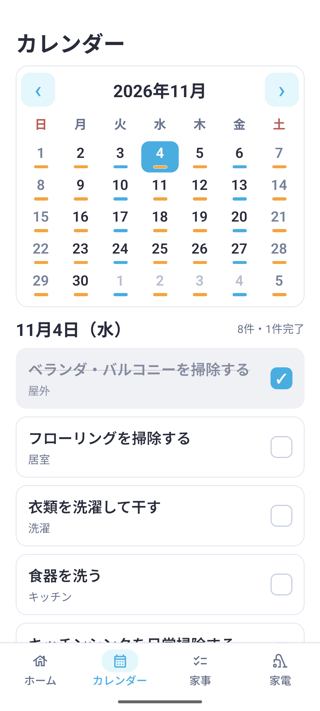
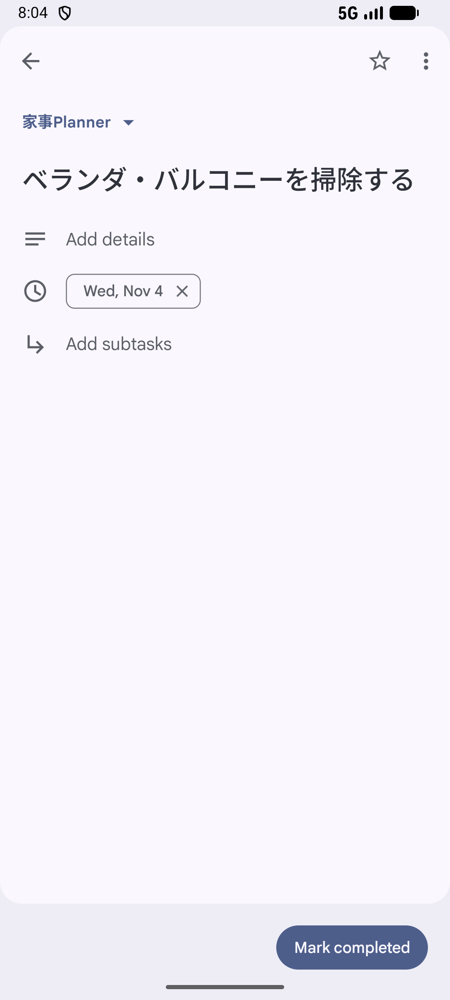

# Android Emulator + 実Googleアカウント E2E（2026-10-26）

## 結果

**Google Tasks / Calendar Phase 3 E2E PASS**。

Android nativeのクリーン再生成・再ビルド後、エミュレーター上のPlannerとGoogle Calendarアプリ内のTasksを実際に操作した。FreeBusy取得、heavy家事の移動、同じGoogle Task IDでのdue更新、Google側での完了、Plannerへの1件だけの取込、プロセス終了・再起動後の保持まで確認した。

Android物理端末と、物理端末を長時間放置した場合のOSによるBackgroundTask実行は未検証。このPASSの対象に含めない。

## 環境と確認方法

| 項目 | 内容 |
| --- | --- |
| 対象 | Medium Phone API 37.0、`emulator-5554` |
| アプリ | `jp.jphacks.tkb2633`、native development build |
| Expo | SDK 58（`~58.0.19`） |
| ネイティブ認証 | `react-native-nitro-google-signin`、実Googleアカウントの既存接続を引継ぎ |
| Google側の画面 | Android版Google Calendarに統合されたTasks |
| タイムゾーン | Asia/Tokyo |
| ビルド時の基点 | `898ca69c4eb2e642131869008700e9111c0ede6c` + 今回の修正 |
| README統合 | 最新mainの`c4bea08`を取り込み、デモ動画・画像・文章構成を保持 |
| 確認手段 | native画面操作、アプリのAPI計測ログ、端末SQLiteの読取スナップショットの照合 |

認証操作とCalendar権限の許可は引継ぎ前にユーザーが実施済み。今回、新規アカウント登録や権限の再承認は行わず、再ビルド後も接続が残り、Tasks / FreeBusyの保護された実APIが成功することを確認した。

検証開始前にSQLite、生成済みAndroidソース、debug keystoreを非公開のローカル領域へ退避した。元のローカルcheckoutの未コミット変更には触れていない。

## 1. Android native再ビルド

```sh
npx expo prebuild --clean --platform android --no-install
npx expo run:android --device emulator-5554 --port 8101
```

Android Studio付属JDKと既存Android SDKを指定して実行した。

- clean prebuild: PASS
- Gradle: `BUILD SUCCESSFUL in 6m 42s`
- debug APKのインストールと起動: PASS
- インストール更新時刻: 2026-10-26 07:20:10 JST
- debug keystore: 再生成前後で同一
- APK SHA-256: `4c63e69dd4b18d46060bde516047e4007abb253cf9366b65144f22267766a42f`

JS側はMetroから読み込むdevelopment buildで検証した。配布用release buildの検証ではない。

## 2. Calendarによるheavy家事の移動と安定ID

14日先までのGoogle同期範囲内で移動を観察するため、「ベランダ・バルコニーを掃除する」だけを一時的に周期3日、実施期間±1日、休日優先OFFに変更した。負荷は`heavy`のまま。検証後は元の定義へ戻した。

| 確認 | Calendar OFF | Calendar ON |
| --- | --- | --- |
| 同じ家事回のPlanner予定日 | 2026-11-03 | **2026-11-04** |
| Google側のdue | 2026-11-03 | **2026-11-04** |
| Task IDのSHA-256先頭16桁 | `20f16a6f33171b71` | **`20f16a6f33171b71`** |
| 対象家事の負荷 | heavy | heavy |

実FreeBusy取得は3リクエストで181日分、うちbusyは47日分。対象日のbusy時間は11月3日が270分、11月4日が90分だった。Calendar ON後のTasks同期は更新62件、新規作成0件で成功した。同じTaskを再利用して日付を更新し、Googleのnative画面にも11月4日が表示された。


## 3. Google側の完了 → Planner取込

Google Calendarアプリ内の対象Taskで「Mark completed」を押し、Plannerの「今すぐ同期」を実行した。

- 完了取込: **1件**
- Googleへの書込: **0件**
- SQLiteの完了元: `googleTasks`
- 保存された対象予定日: **2026-11-04**
- Plannerの11月4日のカード: チェック済み・取り消し線あり
- 次の同一家事回: **2026-11-05**に保持

今回は将来日の予定を検証用に完了した。将来日の完了を過去の実施状態へ前倒し適用しない既存仕様も保持され、未実施時期不明の初回状態は変更されなかった。



## 4. プロセス終了・再起動と再同期

Androidのアプリ履歴からPlannerを終了し、`pidof`でプロセス不在を確認した。ランチャーのアプリアイコンから再起動し、PIDが`9105`から`11528`へ変わったことを確認した。

- 対象完了履歴: **1件のまま**
- 同じTask ID、due、完了状態: 保持
- 次回予定日11月5日: 保持
- Calendar連携ON・取得済み情報: 保持
- 再同期: 新規0、更新0、削除0、取込0、書込0で成功


## 5. 追加確認: Planner側からの完了取消

Plannerの対象カードを未完了に戻した。即時同期は更新1件、新規0件で成功し、同じTask IDの状態が`needsAction`へ戻った。Googleのnative画面で11月4日のTaskが未完了一覧へ戻り、詳細画面にも「Mark completed」が表示された。



## 検証中に修正した問題

1. **長期予定の一括作成**: Plannerの長期生成範囲をそのままGoogleへ送ることで紐付けが増えていた。新規作成を当日〜14日先に制限した。長期のPlanner予定と既存リンクは保持する。
2. **作成・更新の大量送信**: multipartバッチを最大100件ずつへ分割する。205件を100 / 100 / 5に分ける回帰テストを作成と更新の両方へ追加した。
3. **部分成功後の再送**: 成功したTask ID・同期済み項目を先に保存し、次の同期では残差分だけ処理する。ローカル初期化でリンクを失った場合も、専用リスト内で家事名と日付が一致するTaskを再利用する。
4. **同期範囲外へ移動した既存Task**: 14日という上限を新規作成だけへ適用し、既に紐付いたTaskのdue・名前・状態は範囲外でも更新する。
5. **日次固定家事の重複配置**: 毎日固定の家事に古い移動幅が残っていると、busy dayを避けて複数回分が同じ日に集まっていた。実効周期1日の`everyday`家事は日付を固定し、日ごとに1回を維持する。ユーザーが周期を1日より長く変更した場合は通常の周期処理を使う。
6. **Googleの403理由の取り扱い**: 構造化された`reason`と`Retry-After`を保持する。quota由来の403は再試行へ分類し、本当の権限不足と区別する。
7. **同期処理の保護**: Calendar取得失敗がTasksの完了同期まで止めないよう分離し、同期開始状態の保存失敗や同時要求も回帰テストで保護した。

### 実際に発生した403と限界

既存の長期リンクを修正する段階でGoogle側からHTTP 403を受けた。詳細理由を保存する修正後に観測した値は`forbidden`だった。OAuth権限を変更せずに、成功分を残して手動再同期したところ残差分を処理できた。その後のCalendarによる62件更新、完了取込、再起動後の再同期、取消はいずれも成功した。

この403の原因は確定していない。quota由来だったとは断定せず、100件分割でGoogle側の制限や全エラーがなくなるとも扱わない。100件はアプリが1リクエストに含める作成・更新の上限であり、1回のユーザー同期操作全体の件数ではない。

取得したremoteTasksの790件という計測には、削除済み・非表示・完了済みも含まれる。790件の有効な新規予定を今回作ったという意味ではない。

## 検証用データの片付け

周期30日・実施期間±7日・休日優先ONへUIで戻した後、アプリ停止とバックアップ取得を行った。周期の明示的な上書きも残さないよう、対象家事の定義を検証前のJSONと完全一致で復元し、今回だけの取消履歴1件を除いた。これは検証後の片付けであり、上記E2Eの完了操作や保持確認をDB編集で代替していない。

再起動後の実同期で検証用Google Task3件を片付けた。同期結果は成功、新規0、更新36、削除3、取込0。対象3回分の仮の予定・履歴・リンクは0件になり、リンク総数は検証前と同じ600件へ戻った。Google同期状態は`idle`、エラーなし。家事状態も検証前と同じだった。

## 自動検証

- `npm test`: **351 / 351 PASS**、失敗・skipなし
- `npx expo lint`: PASS
- `npx tsc --noEmit`: PASS
- feature contract: **29機能**。既存契約を保持し、バッチ分割・部分成功からの再開、日次固定家事、quotaエラーの回帰防止を追加

画面・ログ・SQLiteから個人情報を除いて照合した値は[verification.json](qa-assets/android-google-e2e-2026-10-26/verification.json)に保存した。Googleアカウント名・メール・生のTask ID・OAuth token・イベント内容・raw DBは含めない。

## 参照した公式資料

- [Expo SDK 58](https://docs.expo.dev/versions/v58.0.0/)
- [Expo development buildsの利用](https://docs.expo.dev/develop/development-builds/use-development-builds/)
- [Google Play servicesの開発環境](https://developers.google.com/android/guides/setup)
- [Google Tasks利用上限](https://developers.google.com/workspace/tasks/limits)
- [Google Tasks tasks.list](https://developers.google.com/workspace/tasks/reference/rest/v1/tasks/list)

開発ビルドとネイティブ変更後の再ビルドはExpoの案内に従った。物理端末のバックグラウンド動作は、このエミュレーターでの検証結果から推定していない。
