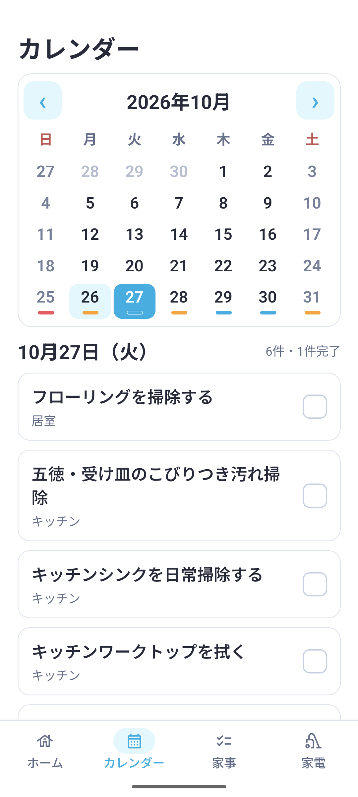
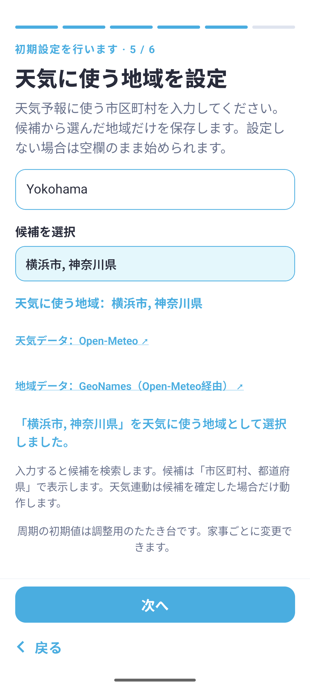
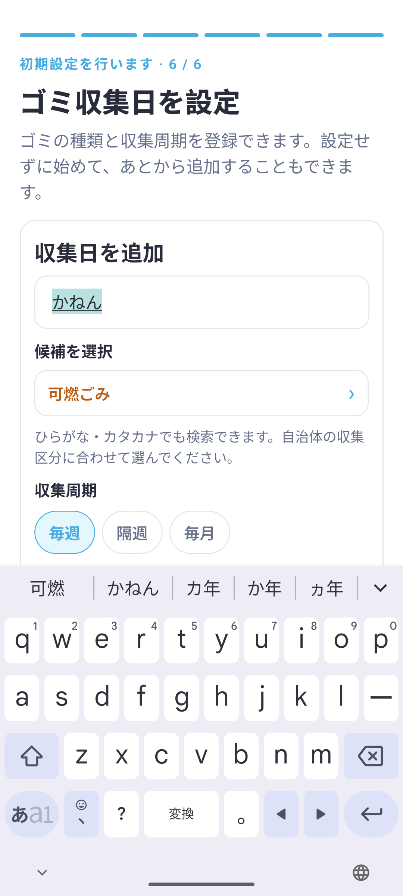

# Android 機能検査と修正 2026年10月26日

Expo SDK 58・React Native 0.88のdevelopment buildをAndroid 17 / API 37 / arm64のエミュレーターで検査した。調査開始時のmainは`13553029baeaa7af3d8535316d031ebb973f3291`。

**状態：保留していた実画面検査を完了。** 初回の[検証データ](qa-assets/android-platform-audit-2026-10-26/verification.json)と、最新の[実アプリ検証データ](qa-assets/resumed-native-audit-2026-10-26/verification.json)を保存する。

Schedulerの依存関係と完了トリガーの同期中断回復について、修正前の失敗を自動テストで再現した。Androidの画面操作では、アプリ終了中のウィジェット完了がGoogleへ伝わらない問題と、英字の市区町村検索が失敗する問題も確認し、修正した。

## Scheduler の依存関係

先行・後続家事を配列の何番目かで対応付けていたため、30日周期の先行家事と毎日の後続家事を同じ10月25日完了から生成すると、後続の最初の予定が10月26日から12月24日へ飛んでいた。同じ7日周期でも最初の予定が抜ける条件があった。

共通の`dependencyPredecessorForDate`で、後続の周期基準日以前にある最新の先行周期を選ぶ。制約に使う日付は、その先行周期の実際の推奨日とする。初回が不明な先行家事については最初の初回予定を待つ。天気で予定を動かしても周期の対応付けは変えない。

洗濯の天気調整にも同じ回数ベースの問題があったため、共通規則へ変更した。先行の洗濯を動かす際は、その周期に依存する後続予定すべてを確認する。

- 30日→毎日の例では、10月26日〜12月31日の67回を保持する。
- 1 / 2 / 7 / 14 / 30日周期を組み合わせた25通りを検査する。
- 同周期の最初の回、初回不明、複数の先行、依存関係の連鎖、天気による前後の移動を保護する。

通常UIには依存関係を編集する画面がない。内部APIなどを通じて依存関係が登録された場合のScheduler本体の修正である。

既存の天気テストは、推奨日が10月27日の先行家事の周期基準日を10月26日へ揃えた。後続と同じ周期に属する先行を追い越せないという検証を維持し、無関係な未来周期を参照する旧挙動を期待しないようにした。テスト・feature contractの削除は行っていない。

## Google 完了同期の中断回復

手動同期と完了同期の実行オプションを共通化し、完了操作でも保存された`syncing`状態を回復できるようにした。生きている同期への合流と完了操作後の追加同期は維持する。完了操作はCalendarの強制再取得を行わない。

Androidで次の操作を行った。

1. アプリを終了してDBをバックアップした。
2. 同期状態と試行時刻だけを変更し、10分以内の中断記録を再現した。
3. アプリを再起動し、その記録が残ることを確認した。
4. カレンダーで10月27日を選び、「食器を洗う」を完了した。
5. 実Google同期が新規0・更新1・削除0で成功した。Task IDは同じで、状態が`completed`になった。
6. 10月27日の表示が6件中1件完了へ変わり、未完了5件の色へ切り替わった。今日の家事状態は変化しなかった。
7. 同じ画面から取り消し、Google側も同じTask IDの`needsAction`へ戻った。

中断記録の再現だけにDB編集を使用した。完了・取消・同期・日付選択は実際のアプリ画面から行った。

完了・取消に伴う通常の予定再生成では、旧来の長い同期範囲に属する不要なTask紐付けも整理された。検査開始時600件から575件へ変わっている。新規作成を14日以内に制限する既存方針を保っており、検査前のTask ID集合を完全に復元したとは扱わない。取り消した家事の状態が検査前と一致し、送信待ちが残らないことはDB比較で確認した。

## Android ウィジェット

修正前はアプリを履歴から終了してウィジェットを押すと、SQLiteに`source=widget`の完了が入る一方、Googleの同期時刻と未完了状態が更新されなかった。

AndroidのKotlin処理にも、アプリ内の完了と同じ`pending_status`と変更リビジョンをトランザクション内で記録する処理を追加した。起動時は未送信のローカル変更を回収する。Google未紐付けのウィジェット完了も、保存された完了時刻から検出する。失敗後の待機時間や権限エラーを毎回の画面復帰で回避しない。

修正版で、プロセスが終了した状態から「シーツ・寝具を洗濯する」をウィジェットで完了した。ネイティブ側の同期待ち記録、アプリ起動後の実Google同期成功、同期待ち記録の消去、履歴のウィジェット表示を確認した。Plannerで取り消した後、Googleの未完了への反映と元の家事状態への復帰も確認した。

Kotlin側でも未来・過去の完了によって、現在の家事状態を不適切に前進・後退させないようJavaScript側と条件を揃えた。

APK更新後、アプリを開く前にウィジェットが操作される場合も考慮する。DBがまだv15以前なら新しい同期待ち列を参照せず、完了記録を保存する。次の起動で通常のマイグレーションを行い、完了時刻から同期へ回収する。ネイティブ処理がDBのスキーマを変更することはない。旧スキーマで実際のネイティブINSERT文を実行し、v16への更新後に同じTask IDへ完了を反映する回帰テストも追加した。

別の差として、JavaScriptの完了処理には有効状態の確認がある一方、Kotlinにはなかった。ウィジェットの表示が残っている間に家事が無効化されると、無効な家事へ完了を書ける条件があった。ネイティブの予定検索を家事定義と結合し、有効な家事だけを対象にした。SQLite上で有効→無効→有効を切り替える回帰テストが修正前に失敗し、修正後に成功することを確認した。

## バックグラウンド起動

Androidの起動ログに`No task registered for key expo-task-manager`が出る経路を確認した。画面のロードを待たず定義されるよう、エントリーポイント`index.ts`でバックグラウンドタスクを読み込んでからExpo Routerを登録する。

画面をマウントしないテストで、タスク定義がRouterより先に行われることと、同期失敗時もSQLite接続が閉じられることを確認する。物理端末での長時間の自律実行・Doze・電池最適化による遅延の検証は含まない。

## 地域検索と日本語入力

英字キーボードで`Yokohama`と入力すると、検索語が`Yokohama市`となり候補が出なかった。英字・全角英字は日本語の接尾辞を付けずに検索するようにした。日本語の「横浜」→「横浜市」の補完は維持する。

修正後に実APIとAndroid画面で「横浜市, 神奈川県」の候補・選択状態を確認した。検査用の地域であり、端末の位置情報は取得していない。

Gboardの日本語QWERTYで「かねん」「びん」を変換中に入力し、対応するゴミ区分の候補が表示され、選択後も正しい登録名を保持することを確認した。

## 家電解析サービス

画面操作が止まっている間に、今回のworktreeから起動した実APIへDyson V12 Detect Slim / SV20を送った。公式製品確認と取扱説明書解析が完了し、78秒で`verified`・お手入れ10項目が返った。クライアントの120秒上限内であり、上限を延ばす変更はしていない。

これは実サービスの検査である。Android画面からの送信・結果確認・登録は下記の続行項目に含める。

## 自動検証とプラットフォーム差

次の表は初回の376件時点。後続の検査を含む最終結果は、両OS条件で671件・43保護項目。

| 項目 | 結果 |
|---|---|
| `npm run check` | lint・型チェック・376テスト PASS |
| `HOUSEWORK_TEST_PLATFORM=android npm test` | 376テスト PASS |
| `npx expo-doctor` | 20 / 20 PASS |
| 既存機能の保護 | 32 feature contracts |
| Android native build | PASS |
| SDKの通知呼び出し | Androidはchannel作成後に権限要求、iOSはchannelを作成しない |
| 家電API接続先 | Android Emulatorは`10.0.2.2`、iOS Simulatorは`localhost`。明示URLを優先 |
| Widget実装 | AndroidはKotlinとJetpack Compose、iOSはSwiftUIとtimelineの保留操作を使用 |

CIも`ios`・`android`のマトリクスにし、従来iOSを既定としていた画面ハーネスをAndroid条件でも実行する。これはネイティブの描画・アニメーション・実アカウント操作の代用ではない。

## 続行した画面検査

ロック解除後は画面操作ツールのクリックが届かず、ユーザーの明示的な許可でADB操作へ切り替えた。最終APK（SHA-256 `fd2c65dabe143210645abb001a1fee1ea37fe97320fb8d79fa61648331d0a295`）をデータを保って更新インストールした。

- 全20家事を無効・前回不明で初期設定を完了。ホーム0件からフローリングを有効化し、周期17日で表示、自動保存、再起動を確認した。無効化・再有効化と周期変更も確認し、最後は標準7日へ戻した。
- 毎週・隔週・毎月のゴミを登録。名前・色・カレンダーの短縮表示、非表示・復元、毎週だけの灰色枠、次回収集日の折りたたみを確認した。
- 通知のOS許可と実配信、OFF時の予約0件、ON時の重複なし13件を確認。検査用に変えた時刻を9:00へ戻した。
- Androidの画面から家電の実AI解析・10項目保存・1項目の予定登録を実施。周期なし9項目の説明も保存し、詳細の反復表示、ヘルプ、クレジットの開閉を確認した。
- 連携済みの別AVDでもセッションを復元し、Calendar OFF/ONが成功。181日・busy 47日を再取得し、575件のTask IDを維持した。

家電名の二重表示を実画面で発見して共通フォーマッターへ修正し、12件の回帰テストを追加した。最終の自動テストはiOS・Android両条件で671件PASS。iOSウィジェットとネイティブUIの追加検査を含む詳細は[保存・通知・家電APIの調査](reliability-audit-2026-10-26.md#実アプリでの再確認)にある。

物理端末の長時間バックグラウンド動作や、エミュレーターの描画から物理端末のフレームレートを保証する検査は含めない。

## 環境とデータの扱い

元のローカルcheckoutの未コミット変更は保持し、既存のworktreeで修正した。ユーザー更新済みREADMEの構成、動画、画像を保持する。

Macの空き容量不足で最初の再ビルドが停止したため、再生成できるXcodeのコンパイラキャッシュを整理した。その後の再ビルドは成功した。エミュレーター自体のクラッシュと起動ダイアログも確認し、データを消さずSwiftShaderで起動を復旧した。アプリのクラッシュとは区別する。

Google連携済みの端末と、初期設定用の端末を分けた。検査前のDBは非公開のローカル領域へ保存し、初期設定用の旧DBも退避した。公開記録へアカウント名・メール・生のTask ID・token・raw DBは含めない。

## 参照した公式資料

- [Expo SDK 58](https://docs.expo.dev/versions/v58.0.0/)
- [Expo SDK 58 Widgets](https://docs.expo.dev/versions/v58.0.0/sdk/widgets/)
- [Expo SDK 58 Notifications](https://docs.expo.dev/versions/v58.0.0/sdk/notifications/)
- [Expo SDK 58 BackgroundTask](https://docs.expo.dev/versions/v58.0.0/sdk/background-task/)
- [Expo SDK 58 TaskManager](https://docs.expo.dev/versions/v58.0.0/sdk/task-manager/)
- [Expo Routerのカスタムエントリーポイント](https://docs.expo.dev/router/installation/)
- [Android Emulatorの描画方式](https://developer.android.com/studio/run/emulator-acceleration)
