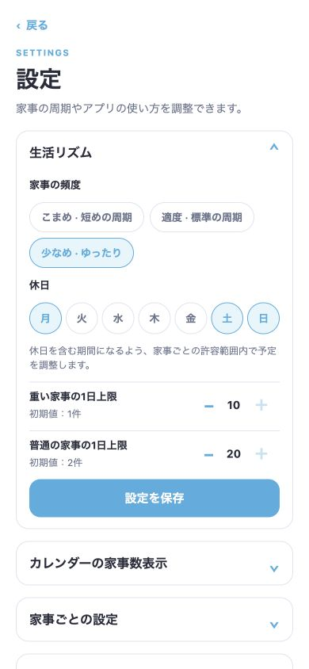
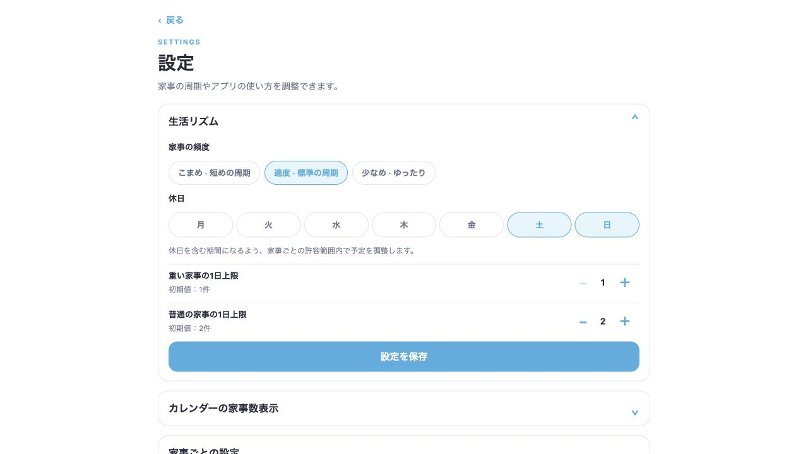

# 期限切れ家事の重複と設定の開閉 修正・検証記録

## 修正した内容

1. 日次家事の直近3周期がそれぞれカードになる問題を修正。同じ日には家事IDごとに1枚を表示する。現在の実施期間と推奨日を優先し、現在の予定がない場合は直近の期限切れを代表にする。
2. ホーム、今週・来週、カレンダー、家事詳細の操作対象、ネイティブ版のウィジェット・通知で同じ選択処理を使用。過去の日付の予定と完了履歴は保持する。通知とウィジェットはWeb版では引き続き無効。
3. 完了後に予定が再生成されても1枚の完了カードを保持。取り消すと未完了の1枚に戻る。ホームのカードのキーを家事IDに固定し、完了切り替え時の退出・入場アニメーションによる一瞬の二重表示も解消。
4. カレンダーの推奨日件数も同じ家事IDの重複を数えないよう統一。家事の並び順は推奨日優先、重い・普通・軽いの順を維持。
5. 設定の開閉を、画面外から内容を移動させる方式から実測した高さを伸縮する方式に変更。カード内でクリップし、閉じ終わると中の操作部品を取り除く。分類内を開いた場合の高さにも追従する。
6. 家事の周期・実施期間・負荷などを編集しても古い期限切れ期間が残る不具合を修正。設定が変わった家事の生成済み予定だけを破棄し再計算する。完了履歴は残す。本文のみの変更では予定を破棄しない。
7. 生活リズムの上限ボタンを保存可能な範囲内で停止。重い家事1〜10、普通の家事1〜20。保存処理でも頻度・曜日・上限を検証し、不正な値は書き込まない。
8. 期間外に遅れて完了した家事で、選択週に実施期間が重ならない場合に横棒の幅が負にならないよう修正。
9. 前回の「軽い家事は推奨日だけ」の仕様に追従していなかったスケジューラーテストの前提と期待値を更新。複数日の期間を確認するテストは普通の負荷にし、軽い負荷の1日期間は別の回帰テストで確認。

## 自動検証

- 修正前: 86件中81件成功、5件失敗。失敗は軽い負荷の期間幅に関する古いテスト前提。
- 修正後: `npm run check` 成功。lint、TypeScript型チェック、99件のテストすべて成功。
- 72通りの設定組み合わせ: 負荷3種類 × 周期1・2・7・30日 × 頻度3種類 × 休日なし・土日。推奨日が期間内、期間幅、期限切れ3日境界、予定IDの一意性を検証。
- SQLiteで日次家事の完了、同時の完了連打、取り消し連打、再読み込みを検証。未完了・完了とも表示対象が1枚、変化のない読み込みでは書き込み0件。
- 保存済み期限切れ期間の幅を変更するテストで修正前の失敗を確認し、修正後に成功。履歴も保持。
- 不正な頻度・曜日・上限の拒否と、最大値の保存・再読み込みを検証。
- ウィジェットと通知の日次重複、完了日の通知抑制、次周期が勝手に完了にならないことを検証。

## ブラウザでの実操作

Expoの公開用Webビルドをローカル配信し、通常の画面操作だけで設定した隔離データを使用。20種類の家事について前回実施を1週間前に設定。スマートフォン幅390×844とデスクトップ幅1280で確認。

- ホームの日次「食器を洗う」が1枚であることを確認。
- 完了、リロード後の完了維持、取り消し、過去の日付からの完了と取り消しを確認。
- 最終ビルドで完了直後・取り消し直後もカード1枚を確認。
- 周期1日・普通負荷・実施期間±2日の重なる設定でも表示1枚を確認。
- カレンダーの日付タップは展開状態を変えず、月移動後も元の選択日を保持。背景タップで開閉することを確認。
- ホームから詳細を開き、戻るとホームへ戻ることを確認。
- 設定の生活リズムを8往復連続開閉。分類内のキッチン8件を展開し、外側の高さが内容に追従することを確認。
- 生活リズムの頻度・休日・上限と、点表示の保存を確認。上限10・20では増加ボタンが無効になることを確認。
- 修正前は開き始めの内容がカードの下端より約98pxはみ出すことを実測。修正後の10回の計測ではカードと内容のクリップを確認し、内容の移動transformはなし。分類を開いた状態では内容高865pxと表示領域高865pxが一致。
- 最終ビルドの操作中のブラウザconsole error/warnは0件。

## 確認範囲

この記録のGUI確認はWebブラウザ。今回の変更でiOS・Androidの新しいネイティブビルドを作成して端末上で確認したものではない。通知・ウィジェットはロジックと既存のレイアウトテストで検証。

## 公開用の書き出し環境

作業用チェックアウトで元のチェックアウトの`node_modules`を共有すると、書き出し資産に元のディレクトリ名が入り、公開先でSQLiteのWebAssembly資産を読み込めないことを検出。一時的に直前の正常なデプロイへ戻した。共有リンクを解除し、このチェックアウト内で`npm ci`を実行して再書き出しし、資産が`assets/node_modules/`配下になることを確認。独立した依存環境でもlint・型チェック・99件のテストはすべて成功。

- コードコミット: `001a3e76d953345211a0f8b8ac01e2fa05e679af`。GitHub ActionsのCIも成功。
- 確認済みデプロイ: `6bcssertlr`。プレビューで起動と開閉を確認後、本番へ昇格。
- 公開URL: https://housework-planner.expo.app/
- 本番URLを再読み込みし、起動とカード内の開閉を確認。読み込まれた`entry-55f0092f777446c7ab9214ec1f637d97.js`が最終書き出しと一致。

